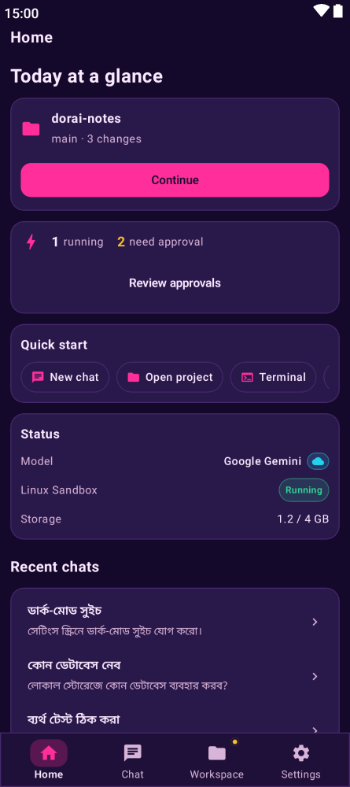
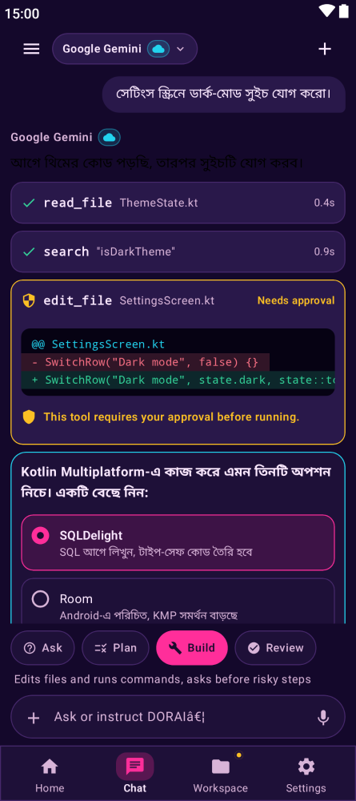
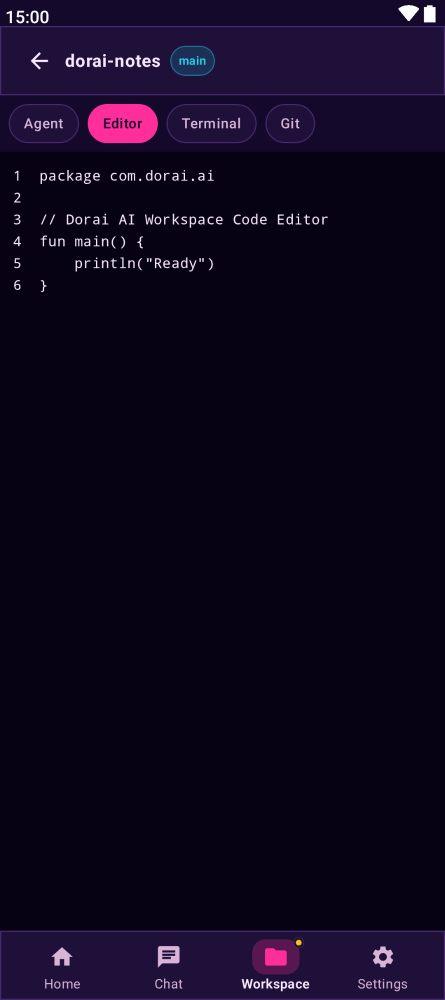
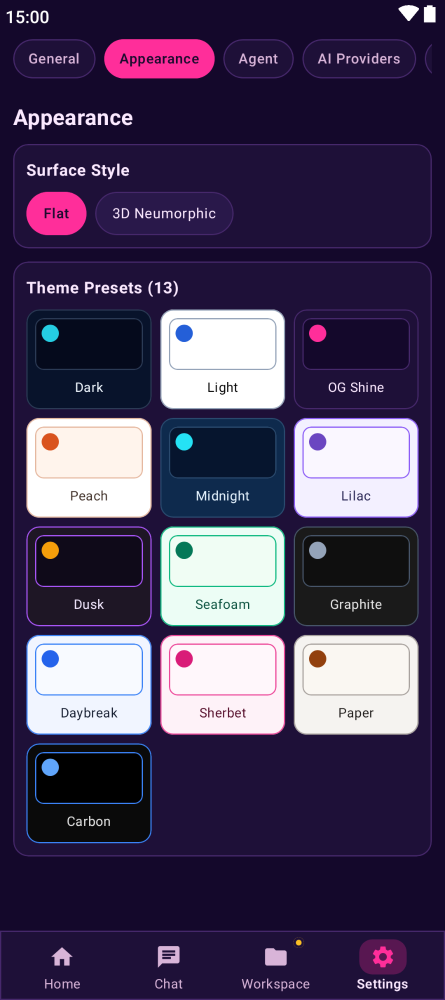
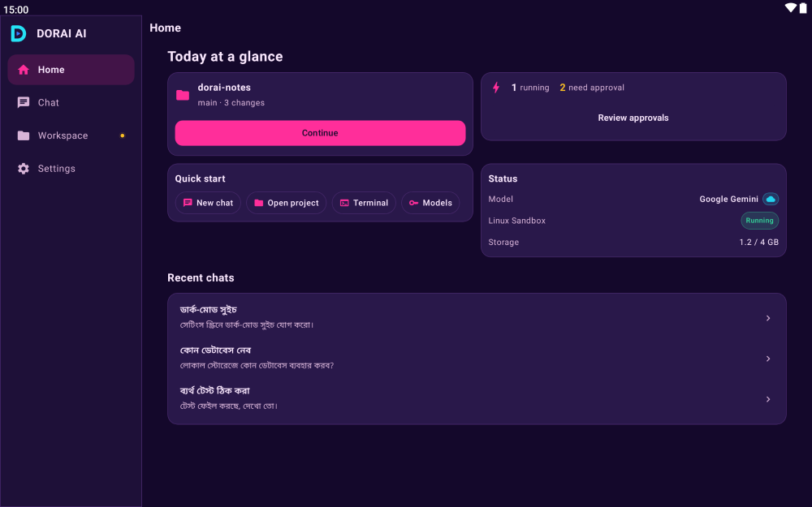
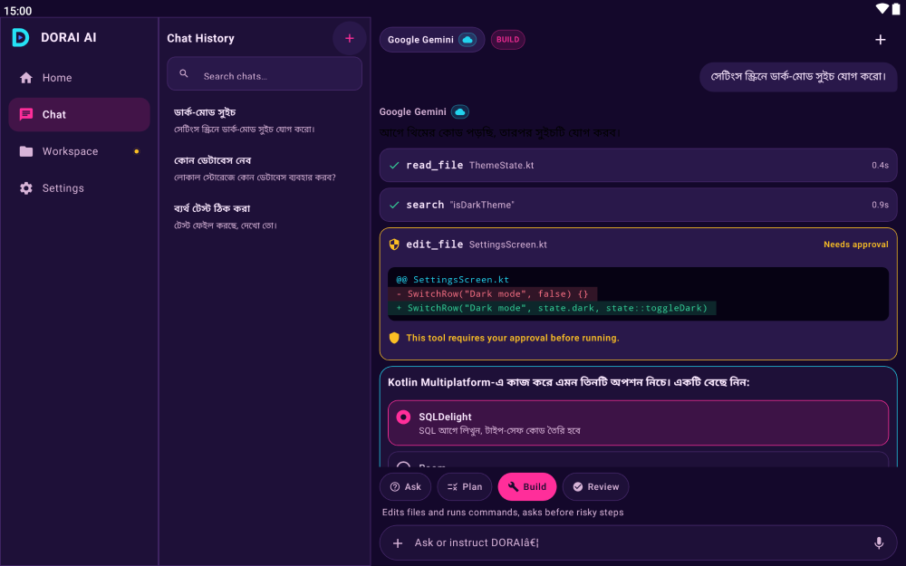

# DORAI AI

<div align="center">


**Your AI. Your World.**

**A Hybrid AI Assistant & Agent Platform** for chat, coding, research, automation, and work across local and cloud environments.

[Repository](https://github.com/habibbrox2/DoraiAi) · [Documentation](docs/) · [Feature specifications](docs/features/)


</div>

## What is DORAI AI?

DORAI AI brings conversational AI and agentic workflows together in one cross-platform application. Use it to talk with AI models, work with tools, develop software, research topics, and automate tasks—with a choice of cloud services and supported local execution.

The project is built primarily with **Kotlin Multiplatform** and **Compose Multiplatform**. Its architecture is designed to support Android, iOS, Windows, macOS, and Linux. Platform capabilities and build readiness may vary; Web/Wasm distribution is still under development.

## What you can do

- **Chat** — Work with multiple AI providers from a unified conversation interface, with Markdown rendering, tool cards, reasoning traces and interactive inline UI.
- **Workspace (DORAI Build)** — An Android-only coding environment: project list, file explorer, built-in editor with syntax highlighting, `git status`/`git diff` panel, and one-tap clone from GitHub.
- **Linux sandbox** — A real Linux shell (Debian or Alpine via proot) on Android: persistent sessions, package management, SSH host configuration, and file browsing. Coding agents (Claude Code, OpenCode, Grok) install on demand into the sandbox.
- **AI agents & tools** — Connect model responses with tools and multi-step workflows: shell commands, file review, web search, memory, MCP servers, scheduled tasks and heartbeat automations.
- **GitHub integration** — Connect a GitHub App with the device flow, browse repositories and clone them (`--depth=1`) into your workspace. Read-only by default; write operations require an explicit opt-in.
- **Research** — Explore questions and information with connected AI services and tools.
- **Autonomous heartbeats** — Recurring agent checks on Android even in the background (tasks, email polling, notification summaries).
- **Interactive dynamic UI** — Agents can render interactive controls inline in the conversation (forms, switches, tables, action buttons).
- **Skills** — Slash-command skills installed into the Linux sandbox and applied per message.
- **Local and cloud AI** — Choose supported cloud providers or run compatible models locally on Android using LiteRT.
- **Persistent memory** — Retain useful conversation context across sessions.
- **MCP integrations** — Connect to Model Context Protocol servers with URL and network protections.
- **Voice and media** — Use text-to-speech and image attachments where supported.
- **Privacy-conscious storage** — Keep conversation data locally with the application's storage protections.

> Feature availability depends on the platform, configured provider, permissions, and execution environment. The Workspace, Linux sandbox and skills are Android-only; iOS and desktop carry the chat, providers and MCP surface today.

> Feature availability depends on the platform, configured provider, permissions, and execution environment.

## Screenshots

Captured directly from production Compose Multiplatform UI running the modern DORAI UI v2 architecture and theme engine.

### Mobile (Compact)

<p align="center">
  
  
  
  
</p>

### Tablet & Expanded (List-Detail Adaptive)

<p align="center">
  
  
</p>

## AI providers and model services

DORAI AI supports a broad range of model services, including:

[OpenAI](https://openai.com) · [Anthropic](https://www.anthropic.com) · [Google Gemini](https://ai.google.dev) · [DeepSeek](https://www.deepseek.com) · [Mistral](https://mistral.ai) · [xAI](https://x.ai) · [OpenRouter](https://openrouter.ai) · [Groq](https://groq.com) · [NVIDIA](https://developer.nvidia.com) · [Cerebras](https://cerebras.ai) · [Ollama](https://ollama.com) · [Together AI](https://www.together.ai) · [Hugging Face](https://huggingface.co) · [Fireworks AI](https://fireworks.ai) · [Perplexity](https://www.perplexity.ai) · OpenAI-compatible APIs · LiteRT on-device models

Provider availability, model catalogs, and free-tier access can change. Check each provider's terms and current model availability.

## Security and privacy

Security is a core engineering focus. Current protections include:

- **MCP request validation** — Validate URLs and destinations, re-check connections, constrain redirects, and sanitize forwarded headers.
- **Shell execution controls** — Use a fail-closed command policy and direct process execution rather than shell-string interpretation.
- **Workspace sandbox isolation** — The Linux sandbox runs without root via proot; agent installers are HTTPS-only with SHA-256 audit logging.
- **GitHub token custody** — Tokens stay in platform vaults (Android Keystore / desktop AES-256-GCM); the credential helper answers github.com only and never puts the token in argv or logs.
- **Android network security** — Restrict cleartext traffic to explicitly permitted local development endpoints.
- **Backup controls** — Disable Android app backup and exclude protected application data from backup rules.
- **Release integrity** — Verify release artifact checksums and updater metadata before installation.

These controls reduce specific attack surfaces; they do not guarantee that every configuration, provider, tool, or execution environment is risk-free. Review the source and security documentation before enabling powerful tools.

## Platforms

| Platform | Project status |
|---|---|
| Android | Primary target — chat, Workspace, Linux sandbox, GitHub integration, heartbeat |
| iOS | Multiplatform target — chat, providers, MCP; no sandbox/workspace yet |
| Windows | Desktop target — chat, providers, MCP; no sandbox/workspace yet |
| macOS | Desktop target — chat, providers, MCP; no sandbox/workspace yet |
| Linux | Desktop target — chat, providers, MCP; no sandbox/workspace yet |
| Web/Wasm | Under development; not currently a release target |

## Downloads and release status

**The first DORAI AI release is not published yet.**

This repository retains historical upstream release entries. Those legacy Kai builds are not DORAI AI releases and should not be installed as DORAI AI.

The first DORAI release will be announced here after the release build, signing identity, package metadata, and update manifest have been verified. Until then, there are no official DORAI AI binaries to download.

## Build and development

DORAI AI uses Gradle and Kotlin Multiplatform. A separate pnpm-managed TypeScript workspace supports future web-facing modules and integrations; it does not replace the Kotlin application runtime.

### Requirements

- JDK 21
- Git
- Android SDK for Android builds
- Node.js and pnpm for TypeScript workspace checks

### Quick start

```bash
# Clone the repository
git clone https://github.com/habibbrox2/DoraiAi.git
cd DoraiAi

# Check the JDK
java -version

# Run the Kotlin tests
./gradlew :composeApp:test
./gradlew :composeApp:desktopTest

# Build the Android debug variant (foss flavor, default)
./gradlew :androidApp:assembleFossDebug

# Run TypeScript workspace checks
pnpm frontend:check
```

Web/Wasm distribution is not release-ready. See the development guides before attempting platform-specific builds.

## Project documentation

- [System architecture](docs/architecture/system-architecture.md)
- [Hybrid architecture](docs/architecture/hybrid-architecture.md)
- [Feature specifications](docs/features/)
  - [Workspace / DORAI Build](docs/features/dorai-build.md)
  - [Linux sandbox](docs/features/sandbox.md)
  - [GitHub integration](docs/features/github-integration.md)
  - [Chat & interactive UI](docs/features/chat.md)
  - [Heartbeat & daemon automation](docs/features/daemon.md)
- [TypeScript workspace setup](docs/development/typescript-setup.md)
- [Hybrid development guide](docs/development/hybrid-development-guide.md)
- [Brand assets and guidelines](docs/branding/dorai/README.md)
- [Brand name usage](docs/branding/brand-name-usage.md)

See [AGENTS.md](AGENTS.md) for repository conventions and [CLAUDE.md](CLAUDE.md) for project-specific development guidance.


## Credits

- DORAI AI project: [habibbrox2](https://github.com/habibbrox2)
- [Mistral AI](https://mistral.ai/)
