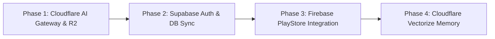

# DORAI AI — Cloud Services Free-Tier Integration Blueprint
**Platforms:** Firebase (Spark Free), Supabase (Free Tier), Cloudflare (Free Plan)  
**Target Repository:** `habibbrox2/DoraiAi`  
**Architecture:** Kotlin Multiplatform (Android, Desktop JVM, iOS, Web Wasm) + Compose Multiplatform  
**Date:** 2026-11-14  

---

## 1. Executive Summary & Codebase Audit

DORAI AI is architected as a local-first AI assistant. A comprehensive read-only audit of the repository reveals the following structural characteristics and limitations:

1. **Local-First SQLite & Settings**:
   - Conversations and messages are persisted on-device in SQLite using SQLDelight (`conversation.sq`).
   - App configuration, memory entries, service tokens, and task schedules reside in `AppSettings.kt` (backed by MultiplatformSettings and platform vaults).
   - **Current limitation**: No multi-device sync exists. Device loss, app uninstall, or switching between Android phone and Desktop requires manual JSON export/import.
2. **KMP Cross-Platform Boundaries**:
   - Core application logic, agent orchestration, and Compose UI reside in `composeApp/src/commonMain/`.
   - Any shared library added to `commonMain` must support Android, iOS, Desktop JVM, and Web (Wasm).
3. **Android Distribution Flavors (`foss` vs `playStore`)**:
   - `androidApp` maintains two distinct flavors:
     - `foss` (default): Pure open-source, strictly free of proprietary Google Play Services / Firebase SDKs.
     - `playStore`: Google Play Store compliant, can include Google Play Review, ML Kit, and Firebase.
4. **Daemon & Background Service Limitations**:
   - On Android, background heartbeats and scheduled tasks rely on an Android Foreground Service (`dataSync` FGS) with a 60-second polling loop.
   - Under Android 15 battery restrictions and aggressive OEM task killers, foreground services can be terminated, stalling background tasks.

---

## 2. Free Tier Capabilities & Quota Analysis

| Provider | Service / Tool | Free Tier Quotas & Features | Key Strengths for DORAI AI |
|---|---|---|---|
| **Supabase** | **Supabase Auth** | • 50,000 Monthly Active Users (MAU)<br>• Email/Password, Magic Link, Google/GitHub OAuth | Multiplatform user accounts and JWT token generation. |
| | **PostgreSQL DB** | • 500 MB database storage<br>• Row Level Security (RLS) built-in | Relational schema directly matching SQLDelight; strict data isolation. |
| | **Realtime** | • 200 concurrent connections<br>• 2,000,000 messages / month | Real-time WebSockets for instant cross-device chat sync. |
| | **Kotlin Multiplatform SDK** | • Official `supabase-kt` library | Runs seamlessly across Android, iOS, Desktop, and Web. |
| **Cloudflare** | **AI Gateway** | • 100% Free with unlimited requests<br>• Multi-provider fallback & response caching | Caches identical LLM prompts; eliminates redundant API spend. |
| | **Workers (Edge)** | • 100,000 requests / day<br>• Global low-latency edge execution | Reverse proxy that shields private API keys and inspects traffic. |
| | **R2 Object Storage** | • 10 GB storage / month<br>• **$0 Egress Bandwidth Fees** | Free egress for image attachments, audio notes, and full backups. |
| | **Vectorize + Workers AI** | • 30M queried vector dimensions / month<br>• Free embeddings (BGE/BAAI) | RAG / Long-term semantic memory at the edge with zero DB load. |
| | **Pages** | • Unlimited bandwidth and static web hosting | Ideal for hosting Web Wasm and hybrid TypeScript workspace. |
| **Firebase** | **FCM (Cloud Messaging)** | • 100% Free & Unlimited push notifications<br>• High-priority & silent data messages | Remote wake-ups for background tasks, resolving Android 15 FGS death. |
| | **Crashlytics** | • 100% Free real-time crash & ANR reporting | Comprehensive crash stack traces across Android and iOS. |
| | **Remote Config** | • 100% Free dynamic key-value parameters | Dynamic model lists, maintenance banners, and instant kill-switches. |

---

## 3. Architecture Blueprint & Separation of Concerns

```mermaid
flowchart TD
    subgraph ClientLayer ["DORAI AI Client Layer (KMP)"]
        UI["Compose Multiplatform UI"]
        SQL["SQLDelight (Local SQLite)"]
        Vault["Platform Vault (Keystore/DPAPI)"]
    end

    subgraph EdgeLayer ["Cloudflare Edge Layer (Zero Egress & AI Shield)"]
        AIG["Cloudflare AI Gateway (Response Caching)"]
        Workers["Cloudflare Workers (Secure API Proxy)"]
        R2["Cloudflare R2 (10GB Media/Backups, $0 Egress)"]
        Vect["Cloudflare Vectorize (Semantic Memory RAG)"]
        Pages["Cloudflare Pages (Web/Wasm Hosting)"]
    end

    subgraph DataLayer ["Supabase Cloud Layer (Auth & Relational Sync)"]
        SAuth["Supabase Auth (50k MAU, OAuth, JWT)"]
        SPostgres["Supabase Postgres (500MB DB with RLS)"]
        SRealtime["Supabase Realtime (WebSockets Sync)"]
    end

    subgraph MobileLayer ["Firebase Mobile Services (PlayStore Flavor Only)"]
        FCM["Firebase Cloud Messaging (Remote Wakeup)"]
        Crash["Firebase Crashlytics (Crash/ANR Logs)"]
        RConfig["Firebase Remote Config (Feature Flags)"]
    end

    UI --> SQL
    UI -->|supabase-kt (commonMain)| SAuth
    UI -->|supabase-kt (commonMain)| SPostgres
    UI -->|supabase-kt (commonMain)| SRealtime
    
    UI -->|Ktor HTTP| AIG
    AIG --> Workers
    UI -->|Presigned URLs| R2
    UI -->|Vector Search API| Vect
    
    UI -.->|playStore flavor only| FCM
    UI -.->|playStore flavor only| Crash
    UI -.->|playStore flavor only| RConfig
```

---

## 4. Detailed Component Mapping

### A. Supabase (Data, Authentication & Realtime)

#### 1. Optional Authentication & Zero-Barrier Guest Mode
- **No Mandatory Login Gate**: Users can launch and use DORAI AI immediately without signing up or logging in. Chatting, tool execution, on-device LiteRT, and sandbox workspaces remain 100% accessible out of the box.
- **Dual-State Persistence Model**:
  - **Guest Mode (Unauthenticated)**:
    - Cloud Sync is **DISABLED**.
    - No user data is sent to or stored in Supabase or Cloudflare.
    - Data is either temporary/local-only (device-bound). If the app is uninstalled or device is cleared, data is permanently lost.
    - UI displays a subtle banner/badge: *"Guest Mode · Cloud Backup Inactive"* with an optional *"Save My Chats"* action.
  - **Authenticated Mode (Signed In)**:
    - Cloud Sync is **ENABLED**.
    - User signs in via Supabase Auth (Email/Password, Magic Link, Google, or GitHub OAuth).
    - All conversations, messages, memories, and settings are securely synced to Supabase PostgreSQL and backed up to Cloudflare R2.
    - Access is isolated at the database level via PostgreSQL Row Level Security (`auth.uid() = user_id`).
    - Cross-device sync is unlocked (instant sync across Android, Desktop, iOS, and Web).
- **Guest-to-Account Upgrade Flow**:
  - When an active guest user decides to sign in, the app prompts: *"Would you like to sync your existing guest conversations to your new account?"*
  - If approved, local SQLDelight records are seamlessly migrated to the user's Supabase cloud account.

#### 2. Bi-Directional Database Sync & Realtime Engine
- Local-first architecture remains intact: SQLDelight SQLite serves as the high-speed local cache.
- When authenticated and online, `ConversationPersistence` pushes incremental diffs to Supabase Postgres.
- Supabase Realtime notifies other active devices (e.g., Desktop or Web) to sync new messages instantly via WebSockets.

### B. Cloudflare (AI Optimization, Edge Security & Storage)
1. **AI Gateway & Request Proxying**:
   - All outgoing LLM completion calls to OpenAI, Gemini, Anthropic, Groq, Cerebras, and OpenRouter route through Cloudflare AI Gateway.
   - **Cost optimization**: Repeated system prompts or identical inquiries are answered directly from edge cache.
2. **Cloudflare R2 Object Storage**:
   - Image attachments, voice notes, and full SQLite backup archives are stored in Cloudflare R2 via presigned URLs.
   - **Zero Egress**: Eliminates bandwidth download costs present in Firebase or Supabase storage tiers.
3. **Cloudflare Vectorize & Workers AI**:
   - Embeds memory entries from `MemoryStore.kt` using Cloudflare's free BAAI/BGE models.
   - Performs cosine similarity search over user memories and past projects directly at the edge.
4. **Cloudflare Pages**:
   - Hosts the compiled `:composeApp:wasmJs` web application and `frontend/` workspace without bandwidth charges.

### C. Firebase (Mobile Notifications & Health — `playStore` Flavor Only)
1. **Push Notifications & Daemon Wakeup (FCM)**:
   - Eliminates continuous 60-second battery-draining polling loops.
   - Scheduled tasks or cloud events trigger an FCM data message, waking up the app to execute task logic cleanly.
2. **Crash & ANR Diagnostics (Crashlytics)**:
   - Captures on-device crashes (including NDK crashes and LiteRT inference errors) in production builds.
3. **Dynamic Configuration (Remote Config)**:
   - Updates recommended free-tier model identifiers and emergency status banners dynamically without requiring an app store release.
4. **FOSS Flavor Isolation Guarantee**:
   - All Firebase dependencies are scoped exclusively to `playStoreImplementation` in `androidApp/build.gradle.kts`.
   - The `foss` flavor remains 100% open-source and free of Google Play Services libraries, honoring repository integrity rules.

---

## 5. Phased Implementation Roadmap



### Phase 1: Cloudflare AI Gateway & R2 Storage (Zero Breaking Changes)
- Route provider endpoints through Cloudflare AI Gateway to enable response caching and latency analytics.
- Implement an R2 presigned URL client for chat attachment uploads and backup archives.

### Phase 2: Supabase KMP Integration (`supabase-kt`)
- Add `supabase-kt` (auth, postgrest, realtime) to `gradle/libs.versions.toml` and `composeApp/build.gradle.kts`.
- Implement `SupabaseAuthService` and connect it to `SettingsTab.Account`.
- Build an incremental sync adapter reconciling local SQLDelight with remote Supabase tables under RLS.

### Phase 3: Firebase Mobile Integration (`playStore` only)
- Apply `com.google.gms.google-services` conditionally for the `playStore` build flavor.
- Add `firebase-messaging` and `firebase-crashlytics` under `playStoreImplementation`.
- Create platform expectation `PushNotificationController` with real FCM implementation on PlayStore and no-op on FOSS/Desktop.

### Phase 4: Long-Term Semantic Memory (Cloudflare Vectorize)
- Connect `MemoryStore.kt` to Cloudflare Vectorize + Workers AI text embeddings.
- Enable semantic retrieval across past chat histories and agent activities.

---

## 6. Safety Guardrails & Quota Protection

1. **Local-First Fail-Closed**: If network connectivity drops or cloud quotas are reached, DORAI AI falls back automatically to local SQLite and local on-device processing.
2. **Egress Immunity**: Heavy assets are strictly stored in Cloudflare R2 to avoid unexpected egress bandwidth charges.
3. **FOSS Integrity**: The `foss` build target remains completely unencumbered by proprietary SDKs.
